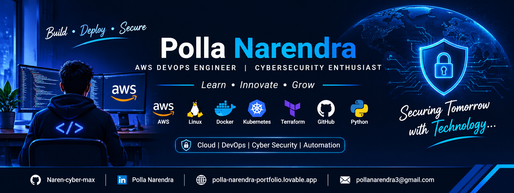

<!-- ================= HEADER BANNER ================= -->

 

<!-- ================= ANIMATED NAME ================= -->

<h3>
☁️ BUILD • AUTOMATE • DEPLOY • SECURE
</h3>

Learning Today | Engineering Tomorrow

 

<!-- ================= SOCIAL LINKS ================= -->

 

---

<!-- ================= ABOUT ME ================= -->

<h2 align="center">👨‍💻 ABOUT ME</h2>

🎓 Final-year B.Tech Computer Science student specializing in
Cyber Security, IoT & Blockchain Technology.

☁️ Interested in AWS Cloud, DevOps Engineering and Cloud Security.

🔬 Developing XAI-SecOps+, an explainable hybrid deep learning
and SOAR-integrated framework for zero-day cloud threat mitigation.

🌱 Currently learning Jenkins, Terraform, Kubernetes, Burp Suite
and SIEM technologies.

💼 Internship experience with APSSDC and Slash Mark.

🎯 Goal: Become an AWS Cloud & DevOps Engineer.

---

<!-- ================= TECH STACK ================= -->

<h2 align="center">🛠️ TECH STACK & TECHNOLOGIES</h2>

<h3 align="center">☁️ AWS CLOUD</h3>

<h3 align="center">⚙️ DEVOPS & AUTOMATION</h3>

<h3 align="center">🔐 CYBERSECURITY & NETWORKING</h3>

<h3 align="center">💻 PROGRAMMING LANGUAGES</h3>

---

<!-- ================= PROJECTS ================= -->

<h2 align="center">🚀 FEATURED PROJECTS</h2>

### 🛡️ 1. XAI-SecOps+ — Final Year Research Project

**Explainable AI-Based Cloud Threat Detection & Autonomous Response**

- Denoising Autoencoder and Transformer Encoder.
- SHAP and LIME explainability.
- AWS CloudTrail security monitoring.
- SOAR-integrated response framework.
- Zero-day threat mitigation research.

### ☁️ 2. AWS Cloud Infrastructure & Monitoring

- EC2 and VPC infrastructure deployment.
- IAM access management.
- S3 storage configuration.
- CloudWatch monitoring and alarms.
- SNS notification integration.
- CloudTrail auditing.

### 🐳 3. Docker Containerization

- Docker image creation.
- Custom Dockerfiles.
- Docker Compose.
- Linux container deployment.

### 🔄 4. CI/CD Pipeline Automation

- Git and GitHub version control.
- CI/CD workflow concepts.
- GitHub Actions automation practice.

---

<!-- ================= GITHUB STATS ================= -->

<h2 align="center">📊 GITHUB ANALYTICS</h2>

 

---

<!-- ================= CONTRIBUTION GRAPH ================= -->

<h2 align="center">📈 CONTRIBUTION ACTIVITY</h2>

---

<!-- ================= PROFILE VISITORS ================= -->

<h2 align="center">👀 PROFILE VISITORS</h2>

---

<!-- ================= FOOTER ================= -->

<h3>🌟 DREAM BIG • BUILD BIGGER • NEVER STOP LEARNING</h3>

  

**Polla Narendra | AWS Cloud • DevOps • Cybersecurity**

